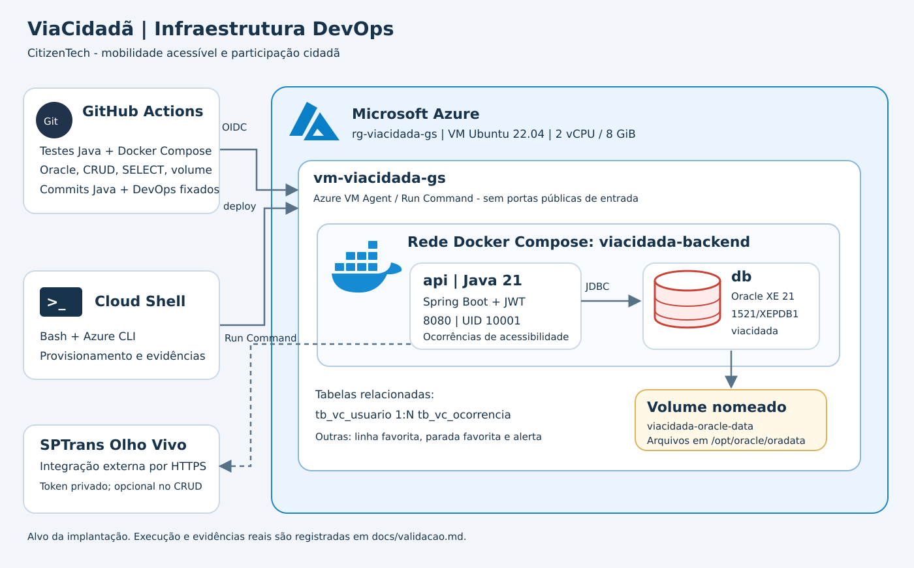

# ViaCidadã - DevOps e Cloud

Global Solution 2026/2 - CitizenTech | FIAP | DevOps Tools & Cloud Computing.

A ViaCidadã apoia a mobilidade urbana acessível e o registro de problemas de
acessibilidade no transporte. Esta entrega executa a API Java do grupo e um Oracle
em containers integrados, dentro de uma VM Ubuntu na Azure. Um terceiro container,
Caddy, oferece HTTPS para o aplicativo quando o perfil `public` está ativo.

**Estado em 17/11/2026:** CI aprovado com 9 testes Java, build Docker, Oracle
real, CRUD autenticado, SELECT com JOIN, persistência após recriar os containers
e encaminhamento do proxy. [Execução e evidências](docs/validacao.md).
A implantação Azure, o HTTPS público e o teste no aparelho físico ainda estão
pendentes do acesso à assinatura. Não há URL pública, vídeo ou PDF final validados.

## Arquitetura



- `api`: Java 21, Spring Boot 3.4.5, JWT, porta 8080, usuário `10001:10001`.
- `db`: Oracle XE 21 em `db:1521/XEPDB1`, usuário da aplicação `viacidada`.
- Rede Compose `viacidada-backend`; a API encontra o banco pelo nome `db`.
- Volume `viacidada-oracle-data`: mantém os dados ao recriar os containers.
- Cinco tabelas do grupo; `tb_vc_ocorrencia.usuario_id` referencia `tb_vc_usuario.id`.
- `depends_on: service_healthy`: a API espera o Oracle estar pronto.
- A administração usa Run Command; SSH, Oracle e a porta 8080 ficam privados.
- O perfil `public` oferece HTTP/HTTPS em 80/443, com redirecionamento para HTTPS.
  O `127.0.0.1` dos testes internos pertence à VM Azure, não ao computador do aluno.

Docker padroniza a aplicação e suas dependências. Compose descreve como os dois
serviços se conectam e persistem dados. A Azure fornece a máquina, disco e rede.
O Actions testa a integração e, depois de configurado, atualiza a VM automaticamente.

## 1. Executar com Docker

Requisitos: Linux x86_64 (ou VM Linux), Git, Python 3, Docker com Compose V2,
8 GiB de RAM e espaço livre para as imagens e o volume Oracle. Para compilar sem
Docker, Java 21 e Maven Wrapper. O Oracle XE desta configuração é x86_64.

```bash
git clone https://github.com/GS-EDUeAMIGOS/gs-devops-cloud.git
cd gs-devops-cloud
python3 scripts/init-env.py
bash scripts/prepare-source.sh
docker compose config --quiet
docker compose build api
docker compose up -d --no-build --wait --wait-timeout 900
bash scripts/verify.sh
```

A primeira inicialização do Oracle pode demorar vários minutos. O `.env` é gerado
com senhas aleatórias e permissão 600. Nunca publique esse arquivo. `.env.example`
documenta as variáveis; não contém credenciais reais. `SPTRANS_TOKEN` é opcional
para o CRUD e necessário para consultas reais da integração externa. Cadastre-o
somente no `.env` privado do servidor. Não use credenciais do Oracle da FIAP aqui.

URLs locais: `http://127.0.0.1:8080/swagger-ui/index.html`,
`http://127.0.0.1:8080/v3/api-docs` e `http://127.0.0.1:8080/actuator/health`.
O perfil ativo é `oracle`, não H2. Não existem os usuários de seed do perfil H2:
o teste cria um cidadão fictício pelo endpoint de cadastro.

### Fonte Java e banco

O [código-fonte Java completo](https://github.com/GS-EDUeAMIGOS/gs-java-api) pertence
ao repositório da disciplina Java. `.java-ref` fixa a versão padrão e
`scripts/prepare-source.sh` baixa exatamente esse commit para `.build/java`, pasta
ignorada pelo Git. Isso evita duas cópias divergentes do código da API.
O Dockerfile compila essa fonte com Maven e copia somente o JAR para a imagem final.

O [SQL original do banco](database/README.md) vem de `gs-database` e é executado
somente na primeira inicialização de um volume novo, no usuário `viacidada`.
A API usa `ORACLE_DDL_AUTO=validate`, sem modificar o schema. A estrutura existente
no Oracle compartilhado da FIAP não é acessada nem alterada por estes scripts.

## 2. Demonstrar CRUD, SELECT e persistência

```bash
python3 scripts/smoke-crud.py create
bash scripts/select-db.sh
docker compose down
docker compose up -d --no-build --wait --wait-timeout 900
python3 scripts/smoke-crud.py check
python3 scripts/smoke-crud.py cleanup
```

Ou execute `bash scripts/test-persistence.sh` para fazer a sequência completa.
O teste cadastra cidadão (201), cria ocorrência (201), consulta (200), atualiza
(200), verifica entrada inválida (400), recria ambos os containers, confirma o
mesmo usuário/ocorrência, exclui a ocorrência (204) e confirma ausência (404).
O `SELECT` é executado dentro do Oracle e faz JOIN das duas tabelas relacionadas.
O usuário sintético permanece para não exigir privilégios administrativos na API.
O estado privado do teste fica em `.evidence-private`, ignorado pelo Git.

**Não use `down -v` na VM:** isso remove o volume. Somente o runner de CI usa essa
opção ao limpar seu próprio banco descartável.

```bash
docker compose ps -a
docker compose logs --tail 60 api db
docker compose exec api sh
docker compose exec -T api id
docker compose exec -T api pwd
docker compose exec -T db id
docker volume inspect viacidada-oracle-data
```

## 3. Criar e implantar na Azure

No Azure Cloud Shell, selecione **Bash**. Confira assinatura, região e quota:

```bash
az account list -o table
export AZURE_SUBSCRIPTION_ID="ID_DA_ASSINATURA_ESCOLHIDA"
export AZURE_LOCATION=eastus
export VM_SIZE=Standard_D2s_v4
git clone https://github.com/GS-EDUeAMIGOS/gs-devops-cloud.git
cd gs-devops-cloud
bash azure/provision.sh
bash azure/deploy.sh
bash azure/verify-vm.sh
bash azure/test-persistence-vm.sh
```

O script cria `rg-viacidada-gs` e `vm-viacidada-gs`, Ubuntu 22.04, 2 vCPU/8 GiB,
disco Standard de 64 GB. Região e tamanho podem ser ajustados conforme a assinatura.
A criação interrompe se o grupo já existir. A VM recebe Docker e Compose pelo
repositório oficial Docker. O deploy compila na própria VM e verifica saúde.
Credenciais novas são geradas na VM em `/opt/viacidada/runtime.env` e preservadas
nas atualizações. Os releases ficam em `/opt/viacidada/releases`, e `current` aponta
para a versão ativa. Não exclua o volume nem gere senhas novas em cada deploy.

O deploy precisa de commits publicados no GitHub. Um commit apenas local não pode
ser baixado pela VM. Para implantar outra versão Java revisada:

```bash
export JAVA_SHA="SHA_COMPLETO_DO_COMMIT_JAVA"
bash azure/deploy.sh
```

## 4. Atualizar a nuvem ao publicar no GitHub

Para acesso do aplicativo no celular, depois do deploy execute
`bash azure/publish-api.sh`. O procedimento e o ajuste da URL Flutter estão em
[acesso Mobile](docs/acesso-mobile.md). O endereço só deve ser compartilhado após
o teste externo emitir `VIACIDADA_PUBLIC_OK`.

O workflow [.github/workflows/ci-cd.yml](.github/workflows/ci-cd.yml) testa a API e
o Compose com Oracle real no runner. O teste de persistência recria os containers.
O deploy só começa após esse job passar e com `AZURE_DEPLOY_ENABLED=true`.

O gancho Java está documentado em [automação](docs/automacao.md). Ao fazer push
na `main` Java, ele chama este workflow com o SHA da API. Pull requests executam
somente validação. A VM compila exatamente os commits testados, com nova imagem
etiquetada pelo SHA; não usa uma tag `latest` para escolher a versão da API.

A integração usa OIDC e Azure Run Command, sem senha de service principal, chave
SSH em secret ou porta 22 aberta. A configuração inicial de identidade e variáveis
precisa ser feita uma vez. Até lá, CI funciona e o job de deploy fica desativado.

## 5. Entrega e apresentação

- [Conferência dos requisitos](docs/requisitos-gs.md).
- [Roteiro de gravação e defesa](docs/apresentacao.md).
- [Endereço público e integração com o celular](docs/acesso-mobile.md).
- [Resultados efetivamente obtidos](docs/validacao.md).
- [Pendências](docs/pendencias.md) e [entrega](delivery/README.md).

Entrega indicada no enunciado: **19/11/2026, até 23h55**. Apresentação presencial
na aula de **23 a 27/11**, valendo 30%. Confirme o dia da sua turma.
Esta GS exige solução em nuvem para a apresentação: não exclua a VM após o vídeo.
Para economizar entre sessões, use `bash azure/deallocate.sh`; disco/IP podem
continuar consumindo crédito. Reinicie com `az vm start -g rg-viacidada-gs -n vm-viacidada-gs`.
Depois da avaliação, `azure/cleanup.sh` permite excluir o grupo com confirmação.

## Equipe

Responsável por DevOps: Erick Ramos Santos. Nomes/RMs conferidos no README Java;
a identificação específica da turma deve ser confirmada antes do PDF final.

| Integrante | RM |
| --- | --- |
| Alisson Kawan Evangelista Silva | 567598 |
| Kenji Fernandes Wakabayashi | 568156 |
| Erick Ramos Santos | 567837 |
| Eduardo Boni dos Santos | 567236 |
| Marcos Vinicius de Jesus Almeida | 567214 |

## Uso de IA

Assistente de IA apoiou a preparação dos scripts, testes de infraestrutura e
documentação. Resultados executados e pendências estão identificados separadamente.
O grupo deve revisar, entender e defender a implementação na apresentação.
